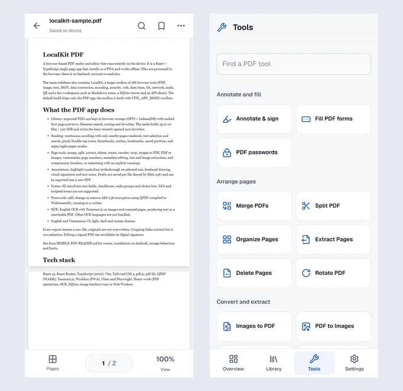

# LocalKit PDF

A browser-based PDF reader and editor that runs entirely on the device. It is a React + TypeScript single-page app that installs as a PWA and works offline. Files are processed in the browser; there is no backend, account or analytics.

<p align="center">
  
</p>

The same codebase also contains **LocalKit**, a larger toolbox of 186 browser tools (PDF, image, text, JSON, data conversion, encoding, security, web, date/time, Git, network, math, QR and a few workspaces such as Markdown notes, a SQLite viewer and an API client). The default build ships only the PDF app; the toolbox is built with `VITE_APP_MODE=toolbox`.

## What the PDF app does

- **Library**: imported PDFs are kept in browser storage (OPFS + IndexedDB) with cached first-page previews, filename search, sorting and favorites. The cache holds up to 20 files / 500 MiB and evicts the least recently opened non-favorites.
- **Reading**: continuous scrolling with only nearby pages rendered, text selection and search, pinch/double-tap zoom, thumbnails, outline, bookmarks, saved position, and sepia/night paper modes.
- **Page tools**: merge, split, extract, delete, rotate, reorder, crop, images to PDF, PDF to images, watermarks, page numbers, metadata editing, text and image extraction, and compression (lossless, or rasterizing with an explicit warning).
- **Annotations**: highlight/underline/strikethrough on selected text, freehand drawing, visual signatures and text notes. Drafts are saved per file (keyed by SHA-256) and can be exported into a new PDF.
- **Forms**: fill AcroForm text fields, checkboxes, radio groups and choice lists. XFA and scripted forms are not supported.
- **Passwords**: add, change or remove AES-256 encryption using [QPDF](https://github.com/qpdf/qpdf) compiled to WebAssembly, running in a worker.
- **OCR**: English OCR with Tesseract.js on images and scanned pages, producing text or a searchable PDF. Other OCR languages are not bundled.
- English and Vietnamese UI; light, dark and system themes.

Every export creates a new file; originals are not overwritten. Cropping hides content but is not redaction. Editing a signed PDF can invalidate its digital signature.

See [docs/MOBILE-PDF-READER.md](docs/MOBILE-PDF-READER.md) for routes, installation on Android, storage behaviour and limits.

## Tech stack

React 19, React Router, TypeScript (strict), Vite, Tailwind CSS 4, pdf.js, pdf-lib, QPDF (WASM), Tesseract.js, Workbox (PWA), Vitest and Playwright. Heavy work (PDF operations, OCR, SQLite, image batches) runs in Web Workers.

## Getting started

Requires Node 20 or newer.

```sh
npm ci
npm run dev          # http://localhost:5173
npm run build        # production build in dist/
npm run preview      # serve dist/ on http://localhost:4317
```

Build the toolbox instead of the PDF app:

```sh
VITE_APP_MODE=toolbox npm run build    # PowerShell: $env:VITE_APP_MODE='toolbox'; npm run build
```

The service worker is only active in the production build, so test offline behaviour with `npm run preview`.

## Tests

```sh
npm run check        # typecheck + lint + contrast/invisible-character checks + unit tests + build
npm test             # Vitest unit and component tests only
npx playwright install chromium
npm run test:e2e     # Playwright against production builds of both app modes
```

See [docs/TESTING.md](docs/TESTING.md) for details.

## Project layout

```
src/
  app/         router, layout and pages
  reader/      PDF app: library, reader, toolkit, annotations, forms, OCR, storage
  tools/       toolbox tools; registry/ holds metadata, <category>/ holds implementations and tests
  components/  shared UI primitives and the CodeMirror editor
  lib/         search, theme, persistence, backup and utilities
companion/     optional local proxy for the toolbox API client
e2e/           Playwright specs
scripts/       build helpers and repository checks
public/qpdf/   vendored QPDF WebAssembly build with its licenses and provenance
```

More documentation: [architecture](docs/ARCHITECTURE.md), [privacy](docs/PRIVACY.md), [browser support](docs/BROWSER_SUPPORT.md), [adding a tool](docs/TOOL_AUTHORING.md), [companion proxy](companion/README.md).

## Privacy

Files, passwords, form values and OCR results stay in the browser. The only network requests are for the app's own static files. In the toolbox build, tools that can use the network (for example the API client) are marked in the UI and send requests only when you trigger them.

## Third-party code and assets

- QPDF 12.4.2 (Apache-2.0) built by [le0pard/qpdf-wasm](https://github.com/le0pard/qpdf-wasm) (MIT), with zlib and libjpeg-turbo; see `public/qpdf/12.4.2/`.
- pdf.js, Tesseract.js and their language data are copied from `node_modules` at build time together with their license files.
- The pdf.js text-layer CSS in `src/tools/pdf/components/viewer.css` is adapted from pdfjs-dist (Apache-2.0).
- The password generator's short word list is the EFF short wordlist (CC BY 3.0).
- Geist fonts via Fontsource (SIL OFL 1.1).
